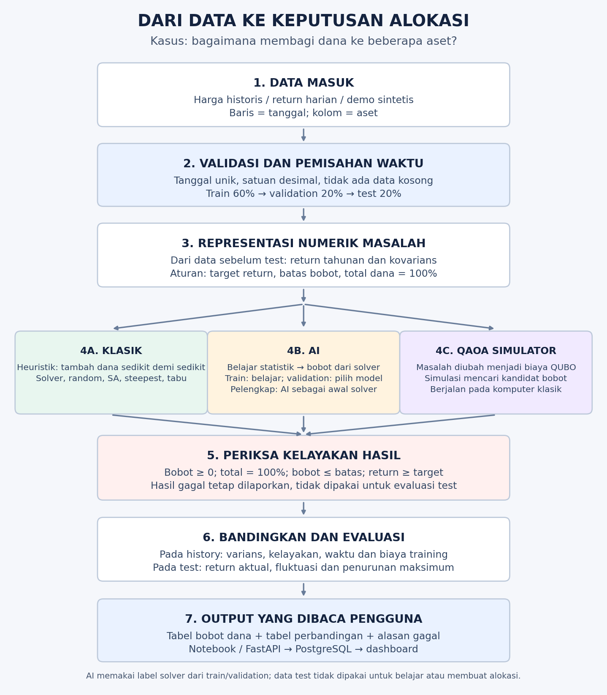

# Mulai dari kasus: panduan pembaca Teknik Fisika

## A. Kasus apa yang sedang diselesaikan?

Bayangkan Anda memiliki **Rp100 juta** dan tiga pilihan aset investasi: A, B, dan C. Pertanyaannya: **berapa bagian dana diberikan ke setiap aset agar fluktuasi portofolio kecil, sementara target imbal hasil tetap terpenuhi?**

Contoh keputusan: A 20%, B 30%, C 50%. Artinya Rp20 juta, Rp30 juta, Rp50 juta. Inilah **output utama: bobot alokasi**, bukan prediksi harga saham besok.

Kasus notebook ini bernama **MinVola** (minimum volatility). Angka yang diminimalkan adalah *varians* return portofolio. Empat aturan keputusan: bobot tidak negatif; jumlah bobot 100%; bobot tiap aset tidak melewati batas; estimasi return portofolio memenuhi target.

Yang dikembangkan adalah **laboratorium perbandingan metode untuk masalah alokasi yang sama**, lalu aplikasi untuk mengunggah data dan membaca hasil. Paper membandingkan metode klasik dan kuantum. AI pada proyek ini merupakan tambahan pembanding/pelengkap.

## B. Hubungkan dengan cara berpikir Teknik Fisika

| Cara berpikir rekayasa | Padanan dalam notebook | Maknanya |
|---|---|---|
| Mengamati sistem dari waktu ke waktu | Harga atau return aset setiap hari | Data mentah berupa deret waktu |
| Mengubah pengamatan menjadi besaran terukur | Perubahan harga relatif (*return*) | Harga Rp100 → Rp103 berarti perubahan +3% |
| Mengekstraksi karakteristik sinyal | Return tahunan, varians dan kovarians | Ringkas tingkat pertumbuhan, fluktuasi dan gerak bersama |
| Memilih variabel keputusan | Bobot dana pada aset A, B, C | Besaran yang bisa diubah algoritma |
| Menentukan fungsi tujuan | Varians portofolio | Biaya matematis yang ingin diperkecil |
| Menentukan batas operasi | Total dana, cap tiap aset, target return | Syarat yang harus dipenuhi solusi |
| Menguji rancangan | Data test pada periode sesudah pengembangan | Periksa perilaku di luar data yang dipakai membuat keputusan |

**Perbedaan domain:** data kasus ini berasal dari pasar keuangan. Kita menggunakan estimasi statistik historis, bukan hukum fisika yang memastikan perilaku pasar berikutnya. Kovarians membantu menggambarkan hubungan antar-aset, bukan membuktikan hubungan sebab-akibat.

Kesulitan membaca notebook dapat muncul ketika perpindahan **kasus → besaran → model → algoritma → keputusan** belum dijelaskan. Pelajari alur ini sebelum menelaah QUBO atau sirkuit kuantum.

## C. Pipeline: data masuk, proses, dan hasil

**Baca diagram dari atas ke bawah.** Ketiga cabang algoritma menerima masalah alokasi dari data sebelum test. AI memiliki proses belajar sendiri: fitur dan label solver dibuat dari train; pemilihan model memakai validation. Semua hasil akhir diperiksa dengan aturan yang sama.

Pipeline notebook menghasilkan bobot, tabel perbandingan, dan evaluasi. Jalur aplikasi menyimpan data/hasil ke PostgreSQL dan menampilkannya melalui FastAPI dan Streamlit. Notebook tidak otomatis menjalankan server/database.

## D. Contoh terkecil: dari harga menjadi return

Harga penutupan aset A kemarin Rp100 dan hari ini Rp103. Return harian adalah `(103 − 100) / 100 = 0.03 = 3%`.

Menggunakan perubahan relatif membantu membandingkan aset dengan harga nominal berbeda. Ini baru satu pengamatan. Untuk memperkirakan karakteristik tahunan dan hubungan antar-aset, diperlukan banyak hari pengamatan.

## E. Contoh output: risiko rendah belum tentu memenuhi aturan

Gunakan angka ilustratif berikut, **bukan data pasar atau hasil utama eksperimen**:

| Aset | Estimasi return tahunan | Simpangan baku tahunan | Batas dana |
|---|---:|---:|---:|
| A | 6% | 10% | 60% |
| B | 9% | 15% | 60% |
| C | 14% | 20% | 60% |

Target return minimal 10%. Untuk mempermudah contoh hitungan saja, anggap kovarians antar-aset nol. Notebook utama menghitung kovarians dari data.

Kita periksa dua usulan pembagian dana. Ini **evaluasi dua kandidat yang diberikan**, belum proses pencarian algoritma.

**Cara membaca hasil:** Usulan A memiliki estimasi fluktuasi lebih rendah, tetapi return 9.05% gagal mencapai target 10%. Usulan B memiliki return 10.90% dan memenuhi aturan pada contoh ini. Jadi algoritma tidak boleh memilih A hanya karena variansnya lebih kecil.

Angka 10.90% adalah hasil perkalian bobot dengan estimasi return historis dalam contoh, bukan keuntungan yang dijamin. Usulan B juga belum dibuktikan sebagai pembagian dana terbaik di antara seluruh kemungkinan.

## F. Bagian mana yang dikerjakan tiap algoritma?

| Metode | Yang dilakukan | Hasil yang diterima pengguna |
|---|---|---|
| Problem-specific heuristic | Coba aset awal berbeda, tambah bobot sedikit demi sedikit, pilih langkah menurut risiko dan target | Kandidat bobot, langkah pemilihan, hasil pemeriksaan kelayakan |
| Solver kontinu | Menyelesaikan fungsi tujuan dan batas secara numerik | Bobot acuan dan status solver |
| Random/SA/steepest/tabu | Mencari kombinasi bit pada representasi biaya QUBO | Kandidat yang diubah kembali menjadi bobot lalu diperiksa |
| AI surrogate | Belajar hubungan statistik masalah → bobot dari contoh keluaran solver | Bobot perkiraan; target return tetap harus diperiksa |
| AI complement | Memakai bobot AI sebagai titik awal solver; bandingkan dengan hasil heuristik | Hasil layak terbaik dari kedua jalur tersebut |
| QAOA simulator | Mensimulasikan rangkaian kuantum untuk menghasilkan kandidat bitstring | Kandidat bobot dan metrik; runtime adalah waktu simulator klasik |

**AI di proyek ini meniru keputusan alokasi solver.** Model ini tidak dilatih untuk meramal harga saham berikutnya. Perannya harus dibedakan dari algoritma forecasting.

## G. Apa output akhirnya, dan bagaimana membacanya?

| Output | Pertanyaan yang dijawab |
|---|---|
| `weights` | Berapa persen dana diberikan kepada tiap aset? |
| `feasible` dan `violations` | Apakah pembagian memenuhi aturan? Aturan mana yang gagal? |
| `expected_return` | Berapa estimasi return dari statistik sebelum test? |
| `variance` / `volatility` | Seberapa besar fluktuasi yang diperkirakan menurut model? Volatilitas adalah akar varians. |
| `runtime_seconds`, `training_seconds` | Berapa waktu metode dan pelatihan AI? |
| `heldout` | Bagaimana bobot tersebut berperilaku pada periode test yang tidak dipakai untuk membuat alokasi? |
| Tabel perbandingan | Metode mana menghasilkan solusi layak dengan varians rendah dan biaya komputasi tertentu? |

Urutan membaca: **cek kelayakan → baca bobot → bandingkan risiko dan waktu → baca hasil test**. Nilai varians kecil pada hasil tidak layak tidak menunjukkan keunggulan metode.

## H. Urutan belajar yang disarankan

1. Selesaikan contoh harga dan dua usulan pembagian dana di atas.
2. Kerjakan bagian 1–4: data → pemisahan waktu → statistik → heuristik. Fokus pada `returns`, `mu`, `cov`, `ub`, `epsilon`, dan `weights`.
3. Baca solver pada bagian 5 untuk memahami metode acuan.
4. Pelajari AI pada bagian 7 dan evaluasi pada bagian 9 setelah alur klasik dipahami.
5. Pelajari QUBO dan QAOA pada bagian 6/8 sebagai representasi dan metode tambahan.

Pada bagian berikutnya, setiap tahap diberi penanda **Input → Proses → Output**. Panduan yang sama tersedia di `docs/MULAI_DARI_KASUS.md`.
